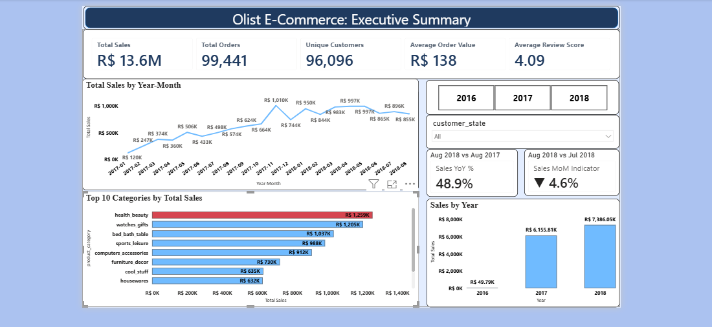
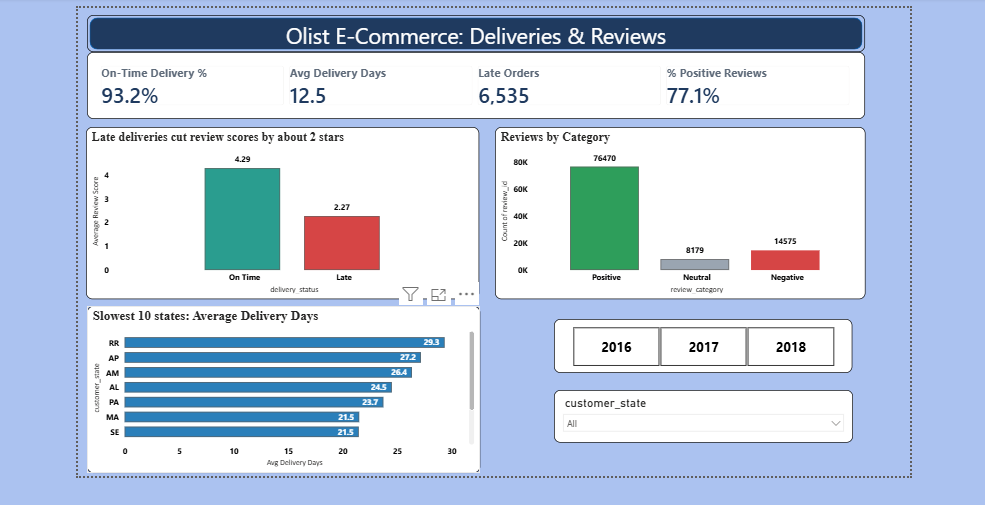
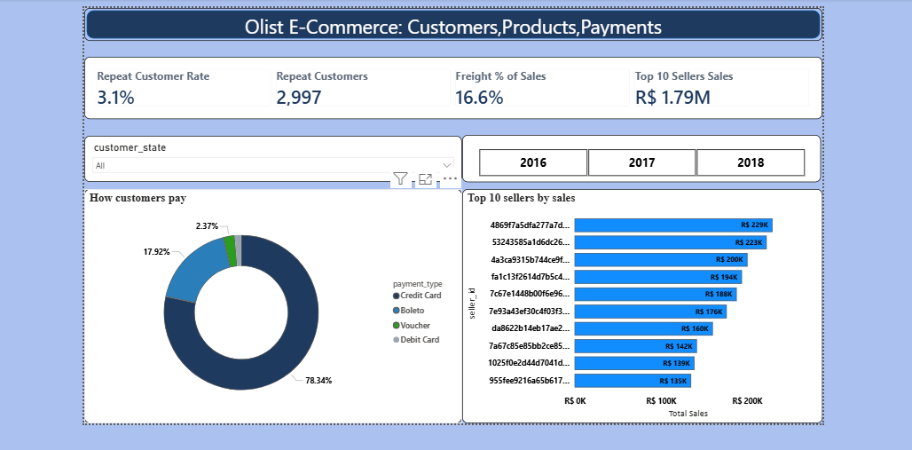
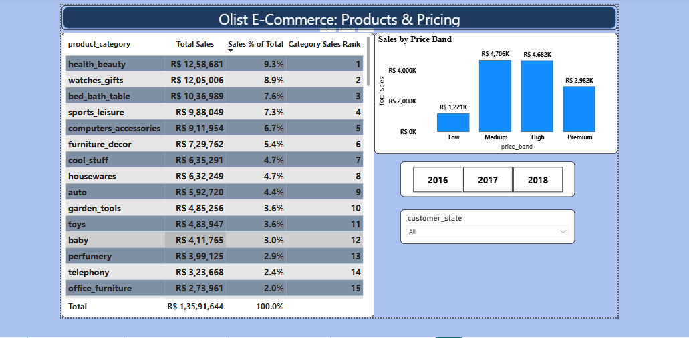

# Olist E-Commerce Analysis: Power BI Dashboard

An end-to-end Power BI project on the Olist Brazilian e-commerce dataset (about 100,000 orders, Sep 2016 to Oct 2018). It covers data modelling, 39 DAX measures, 8 calculated columns and a 4-page interactive dashboard.

## Key findings

| Finding | Number |
|---|---|
| Total sales | R$ 13.6M across 99,441 orders and 96,096 unique customers |
| Average order value | R$ 138 |
| On-time delivery | 93.2% of delivered orders |
| Impact of late delivery on reviews | **2.27 stars when late vs 4.29 when on time** |
| Repeat customers | Only **3.1%** of customers order more than once |
| Freight cost | 16.6% of product sales |
| Top payment method | Credit card, 78.3% of payment value |
| Top category | health_beauty, 9.3% of sales |
| Sales growth | Aug 2018 sales were 48.9% higher than Aug 2017 |

## Dashboard pages

### 1. Executive Summary

### 2. Delivery and Reviews

### 3. Customers and Payments

### 4. Products and Pricing

A PDF export of the full report is included: `Olist_Dashboard.pdf`.

## Data model

Star schema with four fact tables (`fact_orders`, `fact_order_items`, `fact_order_payments`, `fact_order_reviews`) and five dimension tables (`dim_customers`, `dim_products`, `dim_sellers`, `dim_location`, `dim_date`).

Modelling decisions worth noting:
- **Date relationship:** `dim_date` joins to a date-only column (`order_purchase_date`) because the raw purchase timestamp includes a time, which matched only 1 of 99,441 orders.
- **Inactive relationships with `USERELATIONSHIP`:** delivered date to `dim_date`, and seller zip code to `dim_location`.
- **Customer identity:** `customer_unique_id` is used to identify people, since Olist assigns a new `customer_id` to every order.

Full documentation of every measure, calculated column and relationship (with DAX and business meaning) is in [`Olist_Data_Model_Documentation.md`](Olist_Data_Model_Documentation.md).

## DAX techniques used

`CALCULATE`, `DIVIDE`, `SWITCH(TRUE())`, `DATEDIFF`, `TOTALYTD`, `DATEADD`, `SAMEPERIODLASTYEAR`, `ALLSELECTED`, `RANKX`, `TOPN`, `USERELATIONSHIP`, `VAR / RETURN`, and a sort-by-column helper for ordered categories.

## Data quality notes

- 2016 has very little data, and Sep-Oct 2018 is partial, so trend charts cover Jan 2017 to Aug 2018.
- Two orders are marked `delivered` but have no delivery date.
- 7 of 3,095 sellers have zip codes missing from the location table.

## Tools

Power BI Desktop, DAX. Measures and columns were built with AI assistance (Claude, using the Power BI Modeling MCP server) and validated against known totals.

## Files

| File | Description |
|---|---|
| Power BI report (`Olist_Analysis.pbix`) | [Download from Google Drive](https://drive.google.com/file/d/19xDyktUWKT3jdLrPrAbXRuJ2Sf7D2FU3/view?usp=drive_link) (hosted outside GitHub because of file size) |
| `Olist_Analysis.pdf` | PDF export of all 4 pages |
| `01_...04_*.png` | Page screenshots |
| `Olist_Data_Model_Documentation.md` | Measures, columns and relationships |

## Data source

[Brazilian E-Commerce Public Dataset by Olist](https://www.kaggle.com/datasets/olistbr/brazilian-ecommerce) on Kaggle.
